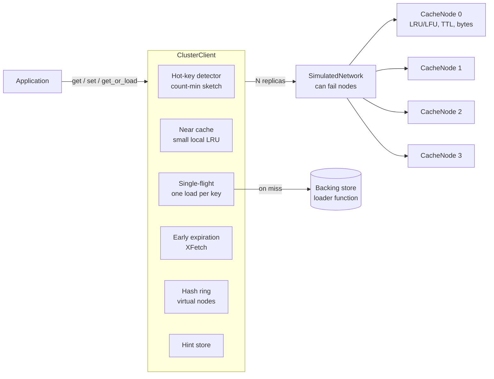

# consistent-hash-cache

A distributed cache cluster in plain Python 3.12, with no runtime dependencies.
It shows the main ideas behind systems like Memcached client rings, Dynamo-style replication, and stampede-safe cache-aside:

- a consistent hash ring with virtual nodes, compared with modulo and rendezvous hashing
- cache nodes with LRU or LFU eviction, TTL, and a memory budget in bytes
- a cluster client with N-way replication, read repair, hinted handoff, hot-key near-caching, request coalescing (single-flight), and probabilistic early expiration
- a simulated network that can fail nodes, plus an asyncio TCP server for a local 3-node demo
- seeded benchmarks whose real output appears below

## The problem

One cache server runs out of memory and becomes a single point of failure. So you spread keys over many servers.
That raises new questions:

1. **Which server owns a key?** `hash(key) % N` is simple, but adding one server moves almost every key. That empties the cache and floods the database.
2. **What happens when a server dies?** Its keys vanish unless they live on more than one server.
3. **What if one key gets most of the traffic?** Its server melts while the others sit idle.
4. **What if a popular key expires?** Hundreds of requests miss at the same moment and all hit the database. This is a cache stampede.

This project answers each question with a standard technique and measures the result.

## Architecture



How a read works:

1. The hot-key detector counts the key. If the key is hot and the near cache has it, the client returns it with no network call.
2. Otherwise the client asks the key's N replicas. It picks the reply with the highest version.
3. Any replica that returned nothing or an older version gets the newest entry (read repair).

How a write works:

1. The client walks the ring from the key's hash and takes the first N distinct nodes.
2. If one of them is down, the client writes to the next healthy node instead and records a hint.
3. `replay_hints()` later copies hinted entries back to the owner once it recovers, then removes the spare copy.
4. Deletes write a short-lived tombstone. Without it, read repair could copy an old value back from a replica that missed the delete.

Code map:

| File | Purpose |
|---|---|
| `src/chcache/hashing.py` | `HashRing`, `ModuloHasher`, `RendezvousHasher`, `remap_fraction` |
| `src/chcache/node.py` | `CacheNode` with O(1) LRU and O(1) LFU, TTL, byte budget |
| `src/chcache/cluster.py` | `ClusterClient`: replication, read repair, hinted handoff, near cache, single-flight, XFetch |
| `src/chcache/hotkeys.py` | Count-min sketch and windowed hot-key detector |
| `src/chcache/singleflight.py` | Thread-safe request coalescing |
| `src/chcache/network.py` | In-process network with node failures and optional packet drops |
| `src/chcache/server.py` | Asyncio TCP server, ring-aware async client, 3-node demo |
| `benchmarks/run_benchmarks.py` | All benchmark tables below |

## Quickstart

```bash
python3.12 -m venv .venv && source .venv/bin/activate
pip install -e '.[dev]'

pytest -q                               # 48 tests
python benchmarks/run_benchmarks.py     # prints tables, writes benchmarks/results.md
python -m chcache.server                # local 3-node TCP demo
```

Use the library:

```python
from chcache import build_cluster

cache = build_cluster(node_count=5, capacity_bytes=1 << 20, replication=3)
cache.set("user:42", "Ada", ttl=60)
cache.network.fail(cache.owners("user:42")[0])   # kill the primary
assert cache.get("user:42") == "Ada"             # served by another replica

profile = cache.get_or_load("user:7", lambda: db.load_user(7), ttl=30)
```

The TCP demo starts three servers on `127.0.0.1` (ephemeral ports), writes 30 keys with replication 2, stops one server, and reads every key back:

```
started 3 servers on 127.0.0.1: {'node-0': 56907, 'node-1': 56908, 'node-2': 56909}
keys per node (replication=2): {'node-0': 20, 'node-1': 22, 'node-2': 18}
stopped node-1
readable after stop: 30/30
```

The servers listen on loopback only and have no authentication. They are a local demo, not something to expose on a network.

## Benchmarks

All numbers come from `python benchmarks/run_benchmarks.py` with seed 42 on Python 3.12. The hashing tables are fully deterministic. The threaded stampede check uses real threads, so it relies on timing, but it gave the same result on every run.

### Hit rate vs cache size

Zipf s=0.99, 10,000 keys, 200,000 requests, 106-byte items, cold start.

| Cache size (% of keys) | Bytes | LRU 1 node | LFU 1 node | LRU 4-node ring | LFU 4-node ring |
|---|---|---|---|---|---|
| 1% | 10 KiB | 37.6% | 47.9% | 37.5% | 47.8% |
| 2% | 20 KiB | 45.9% | 55.0% | 45.9% | 55.1% |
| 5% | 51 KiB | 57.1% | 64.8% | 57.1% | 65.0% |
| 10% | 103 KiB | 66.1% | 71.9% | 66.0% | 72.0% |
| 20% | 207 KiB | 75.5% | 79.4% | 75.5% | 79.4% |
| 50% | 517 KiB | 88.3% | 89.3% | 88.3% | 89.2% |

On a skewed workload, a cache that holds 5% of the keys still serves well over half the requests. LFU beats LRU most when the cache is small, because LRU lets one-off reads push out popular keys. Splitting the same total memory over a 4-node ring costs almost nothing in hit rate.

### Keys remapped when the cluster scales

100,000 keys. Share of keys whose primary node changes.

| Change | Ideal | Ring (160 vnodes) | Rendezvous | Modulo |
|---|---|---|---|---|
| 4 -> 5 (add 1) | 20.0% | 20.0% | 19.9% | 80.1% |
| 10 -> 11 (add 1) | 9.1% | 9.1% | 9.0% | 90.9% |
| 10 -> 9 (remove 1) | 10.0% | 9.1% | 10.1% | 90.0% |
| 50 -> 51 (add 1) | 2.0% | 2.0% | 2.0% | 98.0% |

The ring and rendezvous hashing move about 1/N of the keys, which is the minimum possible. Modulo moves almost all of them, and gets worse as the cluster grows. For removal, the ring moves exactly the keys the removed node owned (9.1% here, close to the 10% ideal).

### Load balance vs virtual nodes

10 nodes, 100,000 keys (mean 10,000 per node).

| Virtual nodes per node | Std dev (keys) | Std dev / mean | Max / mean | Min / mean |
|---|---|---|---|---|
| 1 | 9,967 | 99.7% | 3.68x | 0.20x |
| 4 | 5,101 | 51.0% | 2.17x | 0.44x |
| 16 | 3,065 | 30.6% | 1.73x | 0.61x |
| 64 | 1,128 | 11.3% | 1.19x | 0.84x |
| 160 | 877 | 8.8% | 1.18x | 0.90x |
| 512 | 353 | 3.5% | 1.07x | 0.93x |
| rendezvous | 125 | 1.3% | 1.02x | 0.98x |

With one point per node, the busiest node gets 3.7 times its fair share. More virtual nodes smooth the ring out, at the cost of a bigger lookup table. Rendezvous hashing balances best but costs O(N) per lookup instead of O(log V).

### Stampede protection

Simulated: one hot key, 2,000 req/s for 60 s, TTL 5 s, loader takes 100 ms, warm start.

| Strategy | Backend loads | Peak concurrent loads | Requests that waited on a load |
|---|---|---|---|
| naive | 2,189 | 216 | 2,189 |
| single-flight | 11 | 1 | 2,239 |
| single-flight + early expiration | 13 | 1 | 13 |

Measured with real threads and the real client:

| 64 threads miss one key at once | Backend loads |
|---|---|
| no coalescing | 64 |
| single-flight (`get_or_load`) | 1 |

Without protection, each expiry sends about 200 requests to the database at once. Single-flight cuts that to one load per expiry, but every request that arrives during the load still waits for it. Early expiration (XFetch) refreshes the key a little before its TTL ends, so other requests keep getting the old value and almost nobody waits. The price is a few extra loads (13 instead of 11).

The simulation uses the real `should_refresh_early` function and `Entry` type. It models time as events so a 60-second run takes a fraction of a second.

## Trade-offs and limits

- **Ring vs rendezvous.** The ring gives O(log V) lookups and needs many virtual nodes for even load. Rendezvous needs no tuning and balances better, but each lookup scores every node. It suits small clusters or cases where you pick a few nodes from a large set.
- **Replication costs memory.** With N=3, each value uses three times the space. For a cache, losing data on failure only costs misses, so N=2 is often enough.
- **No quorums.** Writes go to all N replicas and reads ask all reachable replicas. That keeps the code simple and makes read repair easy, but it does not give you R+W>N consistency. Last write wins by version number.
- **Versions come from one client's clock.** `time.time_ns()` with a counter works for one process. Several clients would need vector clocks or a hybrid logical clock.
- **The near cache can serve stale data.** It lives for `near_cache_ttl` (0.5 s by default). A write from this client clears it, but writes from other clients do not. Short TTLs bound the staleness.
- **Hints live in the client.** Dynamo stores hints on the stand-in node. Here the client remembers them, so a client restart loses them. Read repair still fixes the owner on the next read.
- **No data moves on membership change.** When a node joins, the keys it now owns are misses until they are reloaded. That is normal for a cache. A database would need to stream the data over.
- **Sizes are estimates.** The byte budget counts key and value bytes, not Python object overhead.

## System-design interview notes

**Cache-aside vs write-through vs write-behind.**
With cache-aside (what `get_or_load` does), the application reads the cache, loads from the database on a miss, and fills the cache. It is simple and only caches what is read, but the first read is slow and the cache can go stale until TTL or an explicit delete. With write-through, every write goes to the cache and the database together. Reads stay fresh, but writes are slower and you cache data nobody reads. With write-behind, the cache acknowledges and writes to the database later. Writes are fast, but a crash can lose them. For most read-heavy services, use cache-aside with a TTL, and delete the key (do not update it) after a database write. That avoids the race where two writers fill the cache in the wrong order.

**Why consistent hashing.**
With `hash % N`, changing N moves about (N-1)/N of the keys (the table shows 80-98%). Every move is a cache miss, so a resize can take down the database. A ring moves only about 1/N. Virtual nodes fix the uneven arcs you get with one point per server, and let you give a bigger server more points.

**Cache stampede (thundering herd).**
A popular key expires and many requests miss together. Three fixes, which stack:
1. Request coalescing (single-flight or a short lock): one caller loads, the rest wait for its result.
2. Probabilistic early expiration (XFetch): refresh before expiry with a chance that rises as expiry nears and with how slow the load is.
3. TTL jitter: add random spread to TTLs so many keys do not expire at the same second.
You can also serve stale data while one background task refreshes it.

**Hot keys.**
One celebrity profile can send most traffic to one shard, and adding shards does not help. Options:
1. Detect hot keys with a count-min sketch (small, fixed memory) and cache them in each app server's memory for a short time. This project does that.
2. Replicate hot keys to more nodes and read from a random one.
3. Split the key into `key#1 ... key#k` copies and pick one at random per read.
Each option trades freshness or memory for spread.

**Failure handling.**
Replication keeps reads working when a node dies. Hinted handoff keeps writes working by sending them to a stand-in node. Read repair fixes replicas that missed writes, and does it on the read path, so there is no separate repair job. Tombstones stop deleted values from coming back.

**Eviction.**
LRU is cheap and handles recency well. LFU keeps long-term popular keys and resists scans, but it adapts slowly when popularity shifts. Production systems often use an approximation, such as sampled LRU in Redis, or a mix such as W-TinyLFU.

## License

MIT. See [LICENSE](LICENSE).
